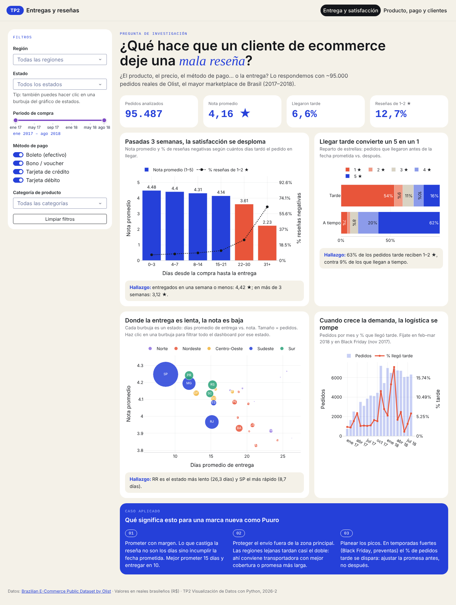
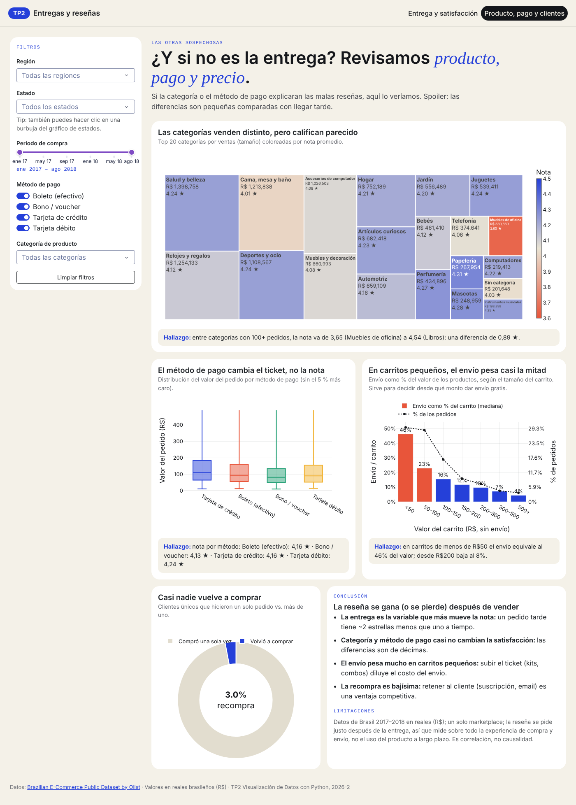

# TP2: Dashboard "Entregas y reseñas"

## Autores
- Juan José Correa
- [Nombre 2]

## Descripción
**Pregunta de investigación:** ¿qué hace que un cliente de ecommerce deje una mala reseña: el producto, el precio, el método de pago o la entrega?

El dashboard analiza ~95.000 pedidos reales del marketplace brasileño Olist. Muestra que la variable que más mueve la satisfacción es la **logística**, y en particular **cumplir la fecha de entrega prometida**: los pedidos que llegan tarde tienen una nota promedio de 2,27 ★ frente a 4,29 ★ de los que llegan a tiempo, y el 63 % de ellos recibe 1–2 estrellas. La categoría del producto y el método de pago apenas cambian la nota.

Como caso aplicado, las conclusiones se traducen en recomendaciones para una marca nueva de ecommerce en Colombia (Puuro).

## Dataset
- **Fuente:** [Brazilian E-Commerce Public Dataset by Olist](https://www.kaggle.com/datasets/olistbr/brazilian-ecommerce) (copia oficial en [GitHub de Olist](https://github.com/olist/work-at-olist-data))
- **Datos crudos:** 7 tablas relacionadas (pedidos, ítems, pagos, reseñas, clientes, productos, traducción de categorías), 99.441 pedidos de 2016 a 2018
- **Tabla final (limpia):** 95.487 filas (pedidos) × 24 columnas
- **Variables principales:** `nota` (1–5), `dias_entrega`, `dias_promesa`, `llego_tarde`, `estado` / `region`, `categoria`, `metodo_pago`, `valor_productos`, `flete`, `flete_pct`, `cliente_recurrente`
- **Moneda:** reales brasileños (R$)

### Limpieza con Pandas (`scripts/preparar_datos.py`)
El script es reproducible: si no encuentra las tablas crudas, las descarga, y en cada paso imprime cuántas filas quita y por qué.

| Paso | Filas quitadas | Justificación |
|---|---|---|
| Solo pedidos con estado `delivered` | 2.963 | La pregunta es sobre la experiencia de entrega; cancelados o en tránsito no tienen fecha de llegada |
| Sin fecha real de entrega | 8 | Inconsistencia: marcados como entregados pero sin fecha |
| Entregas de más de 90 días | 77 | Outliers extremos (0,1 %), casos de pérdida o reclamo que distorsionan los promedios |
| Método de pago `not_defined` | 3 pagos | No se pueden analizar |
| Unión (inner join) de pedidos + ítems + pagos + reseñas | ~640 | Pedidos sin reseña o sin pago válido |
| Meses con menos de 500 pedidos | 263 | Meses incompletos al inicio y al final del dataset que sesgan las series de tiempo |

Transformaciones clave:
- De 7 tablas a una sola tabla **a nivel de pedido** (agregando ítems, pagos y reseñas con `groupby`)
- Variables nuevas: días de entrega, días prometidos, `llego_tarde` (entrega real > fecha estimada), envío como % del carrito, región (agrupando los 27 estados), cliente recurrente (mismo `customer_unique_id` con más de un pedido)
- Categoría principal del pedido = la del ítem más caro; método de pago principal = el que cubrió el mayor valor
- Pedidos con más de una reseña: se promedia la nota
- Traducción de categorías y métodos de pago al español

## Estructura del proyecto
```
tp2_dashboard/
├── app.py                  # App principal: layout general y arranque (expone `server` para gunicorn)
├── requirements.txt        # Dependencias con versiones fijas
├── render.yaml             # Configuración de despliegue en Render
├── README.md
├── data/
│   └── pedidos_limpios.csv.gz   # Dataset limpio (lo genera el script)
├── scripts/
│   └── preparar_datos.py   # Limpieza y unión de las 7 tablas crudas con Pandas
├── utils/
│   ├── datos.py            # Carga (en caché), filtros y KPIs
│   └── graficos.py         # Una función por gráfico de Plotly
├── layouts/
│   ├── componentes.py      # Navbar, panel de filtros, tarjetas reutilizables
│   ├── home.py             # Página principal: entrega y satisfacción
│   └── detail.py           # Página de detalle: producto, pago y clientes
├── callbacks/
│   └── filtros.py          # Todos los callbacks
├── assets/
│   └── style.css           # Estilos personalizados
└── tests/
    └── test_callbacks.py   # Tests de la lógica de los callbacks (pytest)
```

## Instalación local
```bash
pip install -r requirements.txt
python app.py
```
Abrir http://127.0.0.1:8050

Para regenerar el dataset limpio desde cero: `python scripts/preparar_datos.py`
Para correr los tests: `python -m pytest -q`

## Despliegue
- **URL:** https://tp2-entregas-resenas.onrender.com (plan gratuito: si la app estaba inactiva, la primera carga tarda ~1 min)
- **Plataforma:** Render (plan gratuito), comando de arranque `gunicorn app:server`

## Funcionalidades

**Filtros (panel lateral, aplican a las dos páginas):**
- Región (dropdown múltiple)
- Estado (dropdown múltiple, **encadenado**: solo muestra los estados de las regiones elegidas)
- Periodo de compra (range slider por mes)
- Método de pago (checklist con switches)
- Categoría de producto (dropdown múltiple)
- Botón para limpiar filtros

**Página 1: Entrega y satisfacción**
- 4 KPIs: pedidos, nota promedio, % que llegó tarde, % reseñas negativas
- Barras + línea (doble eje): nota y % de reseñas negativas por días de entrega
- Barras 100 % apiladas: reparto de estrellas a tiempo vs. tarde
- Gráfico de burbujas por estado (días vs. nota, tamaño = pedidos). **Clic en una burbuja = filtra todo el dashboard por ese estado** (cross-filtering)
- Barras + línea: pedidos por mes y % que llegó tarde

**Página 2: Producto, pago y clientes**
- Treemap de ventas por categoría coloreado por nota
- Boxplot del valor del pedido por método de pago
- Barras + línea: peso del envío sobre el carrito por tamaño de carrito
- Dona de recompra (clientes que volvieron a comprar)

Cada gráfico tiene un texto de **hallazgo que se recalcula con los filtros**.

**Callbacks (7):** navegación entre páginas, filtro encadenado región→estado, clic en burbuja→estado, limpiar filtros, texto del periodo, actualización de la página principal (11 salidas) y de la página de detalle (7 salidas).

## Capturas de pantalla



## Tecnologías
- Python 3.13
- Pandas, Plotly, Dash
- Dash Bootstrap Components
- Gunicorn (servidor en producción), Pytest

## Conclusiones
- **La entrega es la variable que más explica las malas reseñas.** Hasta las 3 semanas la nota se mantiene sobre 4,1; después cae a 3,6 (22–30 días) y a 2,2 (más de 30 días).
- **Lo que castiga no es solo la demora sino incumplir la promesa:** un pedido tarde tiene en promedio 2 estrellas menos.
- **La geografía importa:** los estados del Norte y Nordeste esperan casi el doble que São Paulo y califican peor.
- **Los picos de demanda rompen la logística:** en Black Friday 2017 y en feb–mar 2018 el % de pedidos tarde pasó del ~3 % habitual a 12–19 %.
- **Categoría y método de pago casi no influyen** en la nota (diferencias de décimas).
- **El envío pesa mucho en carritos pequeños** (~46 % del valor en carritos menores a R$50), lo que justifica estrategias de kits o envío gratis desde cierto monto.
- **La recompra es muy baja** (~3 % de los clientes compra más de una vez).

**Limitaciones:** un solo marketplace, datos de Brasil 2017–2018; la reseña se pide justo después de la entrega, así que mide sobre todo la experiencia de compra; es correlación, no causalidad.

**Qué mejoraríamos:** análisis de texto de los comentarios de las reseñas, un mapa coroplético por estado y comparar con datos de un ecommerce colombiano.
